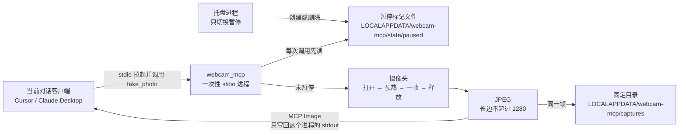

# 本机按需抓拍：最小 MVP 方案

对照日期：2026-10-11。四个仓库都在账号 `1019666077-bit` 下，且与各自上游 **提交完全一致**（`ahead_by: 0`，`behind_by: 0`）。本方案只定边界和动手顺序，不改抓拍代码。

产品名未定。下文称「本机抓拍」。

## 结论

**以 [`webcam_mcp`](https://github.com/pavel-kirienko/webcam_mcp)（本账号 fork：[`1019666077-bit/webcam_mcp`](https://github.com/1019666077-bit/webcam_mcp)，tip `7bbb79e`，包名 `webcam-mcp` 0.1.2，MIT）为底。**

抓拍核沿用它的 `WebcamCapture`：按次打开、预热、取一帧 JPEG、立刻释放，并已写好 Windows 的 DirectShow 回退。明天的改动限在入口、工具注册、暂停标记、固定目录落盘和一个独立托盘进程。

本仓（[`evalstate/mcp-webcam`](https://github.com/evalstate/mcp-webcam) 的 fork，TypeScript，0.2.2）继续只放这份决策。不要把 React/Express 页面包进 Electron 来做托盘。

若明天在目标 Windows 机器上 OpenCV 打不开摄像头，再退回本仓的浏览器 `getUserMedia`。那是验证失败后的退路。

## 已定需求（验收用）

| 需求 | MVP 里的含义 |
| --- | --- |
| 开发者优先 | 用 Cursor / Claude Desktop 的 `mcp.json` 以 stdio 拉起。不先做安装包、账号、签名。 |
| 按需抓拍 | 唯一触发是当前对话调用一次工具。调用结束摄像头必须释放。 |
| 画面只给当前对话机器人 | 图像以 MCP Image 写回调用进程的 stdout。不监听网络，不发给别的会话。 |
| 可本机落盘 | 同一帧再写一份到用户本机固定目录。路径由服务端决定，模型不能选。 |
| 聊天触发 + 托盘可暂停 | 对话负责抓拍。托盘只做暂停/恢复，上面没有抓拍按钮。 |
| 端先不定，倾向 Windows | 抓拍核保持现有跨平台 OpenCV。明天只在 Windows 10/11 上验收。控制端先做 Windows 托盘。 |

做完的样子：

1. Windows 上，Cursor 一条新对话说「拍一张」，只这一条对话拿到一张 JPEG。
2. 工具返回后，其他应用能再次打开同一摄像头。
3. 托盘点暂停后再说一次：对话里没有图像，摄像头灯不亮，captures 目录不新增文件。
4. 本机没有为抓拍而监听的 HTTP 端口。

## 四个上游对照

| | 本仓 `mcp-webcam` | `videocapture-mcp` | **`webcam_mcp`（选用）** | `OpticMCP` |
| --- | --- | --- | --- | --- |
| 上游 | evalstate/mcp-webcam | 13rac1/videocapture-mcp | pavel-kirienko/webcam_mcp | Timorleiderman/OpticMCP |
| 语言 / 体量 | TypeScript。Express + React 页面 + MCP | 单文件 `videocapture_mcp.py`（约 230 行） | Python 包。`camera.py` + `server.py` + `cli.py`，带 mock 测试和 CI | Python 包。约 37 个工具，另有一份完整愿景文档 `TODO.md` |
| 协议 | stdio，或 streamable-http（`/mcp`） | FastMCP 默认 stdio | **只跑 SSE，默认 `0.0.0.0:8000`** | FastMCP 默认 stdio |
| 抓拍 | 页面里的摄像头常开。工具经 SSE 让页面 `getScreenshot()`，把 data URL 回给调用方 | `quick_capture`：打开、一帧、关闭 | `take_photo`：打开、丢掉 5 帧、一帧 JPEG、`release` | `save_image`：打开、丢掉 5 帧、**写成文件、只回文字** |
| 谁拿到像素 | 调用工具的那个 MCP 客户端。另有 Sampling：页面可以把图推给选中的会话 | 调用方，MCP `Image` | 调用方，MCP `Image` | 模型只拿到路径和元数据。像素在磁盘上 |
| 本机落盘 | 无 | 无 | 无 | 有。路径由工具参数 `file_path` 传入 |
| 暂停 / 托盘 | 无。页面上有冻结帧和可选定时刷新 | 无 | 无 | 无。另有 `start_stream` / dashboard，把 MJPEG 开在 localhost |
| Windows | 浏览器能开就能用。截屏走 `getDisplayMedia`，要用户手势 | README 写了 Claude Desktop 配置。代码未指定 `CAP_DSHOW`，也没有预热 | `camera.py` 在默认后端失败后用 `CAP_DSHOW` | `usb.py` 用默认 `VideoCapture(index)`。允许目录的环境变量按 `:` 切分，盘符会被切断 |
| 许可与维护 | MIT。上游约 123 star，本 fork 最后同步 2025-10-22 | README 写 MIT，**仓库没有 LICENSE 文件**。约 19 star，停在 2025-03-28 | MIT。PyPI `webcam-mcp`。约 4 star，2026-01-26 | MIT。PyPI `optic-mcp` 0.6.0。约 4 star，2026-01-03 |
| 和已定需求的距离 | 对话可以触发 `capture`，但摄像头挂在浏览器页上；多会话和 Sampling 是第二条出图路径；托盘意味着换壳 | 按需和 stdio 的形状对，但没有 Windows 后端、预热、测试和可用的打包入口 | 按需、回图、Windows 后端、测试都在。差在默认把 SSE 绑到所有网卡，以及没有暂停和落盘 | 落盘是一等能力，但不出 Image；工具面是视觉平台（RTSP、检测、人脸、对象） |

星数是 2026-10-11 的公开数字，只说明演示热度，不作为选型依据。

### 选用 `webcam_mcp` 的原因

`src/webcam_mcp/camera.py` 的 `capture_photo` 已经是「按需」：每次新建 `VideoCapture`，预热，编码 JPEG，`finally` 里 `release`。Windows 打不开默认后端时会再试 `cv2.CAP_DSHOW`。`tests/` 用 mock 摄像头，CI 不依赖真机。

把它收成 MVP，改动面是：

- `cli.py`：默认传输改为 stdio，MVP 入口不再 `listen`。
- `server.py`：不注册 `record_video`；`take_photo` 先读暂停标记；成功后写固定目录。
- 新的托盘进程：只读写暂停标记。
- 测试补暂停和落盘。

`camera.py` 的打开—预热—释放不动，除非明天真机验证失败。

### 另外三个留作参照

**本仓。** `capture` 在页面已经拿到摄像头权限时，可以由对话触发（`webcam-server-factory.ts` 向浏览器 SSE 发 `{type:"capture"}`，再把图放进工具结果）。这证明「聊天触发 + 只回给调用方」在协议层成立。但摄像头生命周期在网页里，不在 MCP 进程里。`screenshot` 使用 `src/utils/screenCapture.ts` 的 `getDisplayMedia`，需要用户手势，不能当成稳定的聊天触发。streamable-http 下一个 user 可以挂多个会话；Sampling（`server.ts` 的 `/api/process-sample`）还能把画面推给另一个客户端。README 已写明托管实例 `webcam.fast-agent.ai` 是演示，不是安全边界。要加托盘，就得把这套 Vite/React/Express 再包一层桌面壳，改动面比改 Python 入口大。

**`videocapture-mcp`。** `quick_capture` 的语义和我们要的一样，而且默认就是 stdio。它不适合当底：没有预热（第一帧经常是黑的）、没有 DirectShow 回退、没有测试；`pyproject.toml` 的脚本入口写成 `videocapture_mcp.main`，仓库却是根目录单文件；`list_active_connections` 在 `return` 之后还有一行到不了的 `mcp.run`。仓库没有 LICENSE 文件。这些要先补齐，明天就不是在做暂停和落盘。

**`OpticMCP`。** 设计原则写在 `TODO.md`：为省 token，捕获结果落盘，函数不回原始图像。这和「画面给当前对话机器人」相反——客户端不一定会把本地文件再塞进模型上下文。`save_image` 的路径来自模型参数；允许目录包含下载目录、文档目录和当前工作目录。`start_stream` 会在本机开 MJPEG。人脸检测、`detect_objects`（MobileNet SSD）都不在这次范围内。把它裁到只剩 USB 一帧，等于删掉产品主体，不是小改。

可以借用、但不要整模块搬过来的两点：

- 本仓：图像只出现在本次工具结果里；任何 HTTP 共享都要当成越界。
- OpticMCP：落盘目录要收紧。我们收得更死——目录写死，不接受 `file_path` 参数。另外，OpenCV 往 stderr 打日志会弄坏 stdio 帧；OpticMCP 在 import cv2 之前做了 fd 级压制。明天若看到帧被污染，照这个处理，不把日志打到 MCP 进程的 stderr。

## 最小功能清单

### 要做

1. **一个工具 `take_photo`。** 无参数。打开配置里的摄像头索引（默认 0），预热，取一帧，编码 JPEG，释放设备，把 MCP Image 返回给调用方。长边超过 1280 时先缩小再编码，避免一帧撑满对话上下文。现有默认 1920×1080、质量 90 只作为请求分辨率；摄像头不理睬时仍要有这道缩小。
2. **stdio，且由当前客户端拉起进程。** Cursor 侧目标配置：

   ```json
   {
     "mcpServers": {
       "webcam": {
         "command": "uv",
         "args": ["run", "--directory", "C:\\path\\to\\webcam_mcp", "webcam-mcp"]
       }
     }
   }
   ```

   今天的 0.1.2 入口只会跑 SSE，这段配置要等明天改完入口才成立。
3. **暂停标记。** 文件存在即暂停，删除即恢复。Windows 默认 `%LOCALAPPDATA%\webcam-mcp\state\paused`。环境变量 `WEBCAM_MCP_STATE_DIR` 可改位置，方便测试。暂停时 `take_photo` 返回文字错误（`isError`），**不调用** `_open_camera`。
4. **本机落盘。** 与返回 Image 同一帧，写入 `%LOCALAPPDATA%\webcam-mcp\captures\YYYYMMDD-HHMMSS.jpg`。可用 `WEBCAM_MCP_CAPTURE_DIR` 改目录。模型看不到、也改不了这个路径。暂停时不写。
5. **Windows 托盘。** 独立进程，只用 `pystray` 切换暂停标记，并显示「可抓拍 / 已暂停」。不抓拍、不预览、不开浏览器。
6. **失败变成对话里的文字。** 摄像头被占用、权限被拒绝、设备索引不对，沿用 `WebcamError` 的说明返回给模型。工具调用要结束，不能挂住。

### 明确不做

- `record_video`（最多 60 秒、50 帧）。函数可以留在 `camera.py`，MCP 不注册。
- SSE、streamable-http、`0.0.0.0`、多用户、Sampling、托管演示。
- 浏览器页面、冻结帧、定时刷新、屏幕共享。
- 托盘上的抓拍按钮、全局热键、定时抓拍。
- RTSP / HLS / MJPEG / ONVIF、二维码、人脸和物体检测。
- 让模型传入保存路径、分辨率或「开始推流」。
- macOS 菜单栏、Linux 托盘、安装包、代码签名、开机自启。暂停标记的路径规则留成以后换端时只改托盘进程。
- 两个客户端同时抢摄像头时的锁服务。第二个人打开失败就回错误文字。

## 架构草图



暂停时，`take_photo` 在读到标记后直接返回文字，下半段不执行。

进程拆开的原因：MCP stdio 进程由客户端随对话拉起，对话结束就退出。托盘若放进这个进程，刹车会跟着对话一起消失，消息循环也容易和 stdout 上的 MCP 帧打架。暂停状态放在文件里，托盘可以比某一次对话活得更久。

```text
对话进程  --stdio-->  webcam-mcp (take_photo)
                         |
                         | 读
                         v
托盘进程  --写-->  state/paused
                         ^
                         | 未暂停时才打开
                      摄像头 --> stdout 图像
                             \-> captures/*.jpg
```

## 风险

1. **Windows 摄像头独占。** Teams、Zoom、相机应用占着设备时，`VideoCapture` 会失败。必须把 `WebcamError` 收成工具的文字结果。不要在失败路径上重试循环，以免把灯打闪。
2. **`opencv-python-headless` 可能没有能用的 DirectShow/MSMF。** 依赖现在是 `opencv-python-headless`。明天用真机确认；打不开就换成 `opencv-python`。这只换依赖，不换抓拍流程。两条都不通，才启用本仓浏览器退路。
3. **预热不够会出黑帧。** 现有实现丢掉 5 帧。若真机仍是黑的，只增加丢掉的帧数或在编码前看亮度。不要改成服务启动时占住摄像头——那会变成常开采集，也挡住别的应用。
4. **stderr 污染 stdio。** OpenCV 和托盘都不能往 MCP 进程的 stderr 打。托盘是另一个进程，天然避开。OpenCV 若仍打印，在 import 前做 fd 级压制。
5. **「只给当前对话」管不到客户端自己的日志。** 我们能保证的是：不监听端口、不广播、暂停时不采集、工具结果只进拉起这个进程的那个客户端。Cursor / Claude 若保存对话，图像会留在它们的记录里。README 里写这一句。
6. **默认不暂停。** 开发者没打开托盘时，标记文件不存在，对话可以抓拍。这是开发者优先的取舍。README 写明：没开托盘就没有刹车。MVP 不做「必须先开托盘才能拍」。
7. **落盘是第二份拷贝。** captures 目录不通过 HTTP 暴露，也不进工具的可选路径。卸载或清理方式明天用一句 README 说明（删目录即可），不做回收策略。
8. **SSE 回归会直接破坏边界。** 即便绑在 `127.0.0.1`，本机其他进程也能来要图。现有 CLI 默认 `0.0.0.0`，局域网也能要。MVP 入口去掉这段监听，而不是「先听着、文档里提醒」。
9. **OpenCV 在这台机器上不可用。** 退路是本仓：页面保持 `getUserMedia`，对话仍走现有 `capture` 工具；暂停标记同一份，页面收到 capture 事件时先读标记，暂停则回错误、不调用 `getScreenshot()`。截屏工具、Sampling、streamable-http 多用户仍然不开。这是退路，明天先走 OpenCV。
10. **`videocapture-mcp` 没有 LICENSE 文件。** 不从那里复制实现。要借鉴的「打开即关」语义，`webcam_mcp` 里已经有。

## 明天动手顺序

仓库：`1019666077-bit/webcam_mcp`。不要在本仓的 `server.ts` / `webcam-server-factory.ts` 上改。

1. 从与上游一致的 `main`（`7bbb79e`）拉分支。读 `src/webcam_mcp/camera.py`、`server.py`、`cli.py`，确认默认值没有漂移：SSE、`0.0.0.0:8000`、照片 1920×1080、预热 5 帧、`record_video` 最长 60 秒 / 50 帧。
2. 在 Windows 真机上跑一次现有 `capture_photo`（索引 0）。记录：实际分辨率、JPEG 字节数、摄像头灯是否在返回后熄灭、被 Teams 类应用占用时的报错原文。headless 打不开就换 `opencv-python` 再跑一次。
3. 改 `cli.py`：`server.run(transport="stdio")`，去掉 MVP 路径上的 `--host/--port` 监听。`server.py` 不再把 `record_video` 注册成工具。
4. `take_photo` 入口读暂停标记；暂停则返回文字错误。用现有 mock 测试覆盖「暂停时 `VideoCapture` 不被构造」。
5. 未暂停时走原 `capture_photo`。长边大于 1280 则缩小后再 JPEG。同一字节写入 captures 目录，再作为 MCP Image 返回。测试用 `WEBCAM_MCP_CAPTURE_DIR` 指向临时目录。
6. 新增托盘脚本：菜单只有暂停/恢复和退出。退出只关托盘，不删历史图片。手动点一次暂停、一次恢复，看标记文件出现和消失。
7. 按上面的 `mcp.json` 接入 Cursor。一条对话抓拍成功；暂停后再抓拍，确认无图、灯不亮、目录无新文件。再用 `netstat` 确认没有新增监听端口。
8. 更新该 fork 的 README：stdio 配置、托盘怎么开、没开托盘就没有刹车、图像会进入当前客户端的对话记录、captures 目录在哪。本仓这份文档不用再改，除非第 2 步判定要走浏览器退路——若走退路，在本文件末尾加一节「验证结果」，写明机器和失败现象。

第 2 步若两条 OpenCV 包都失败，停掉第 3–6 步，改做风险 9 的浏览器退路，并仍然不要做托盘抓拍按钮和 HTTP 多会话。
